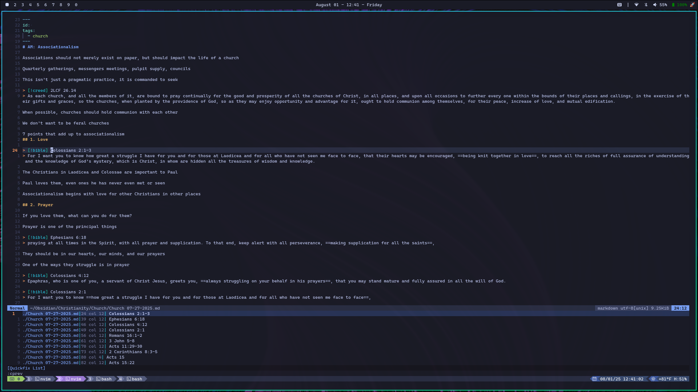
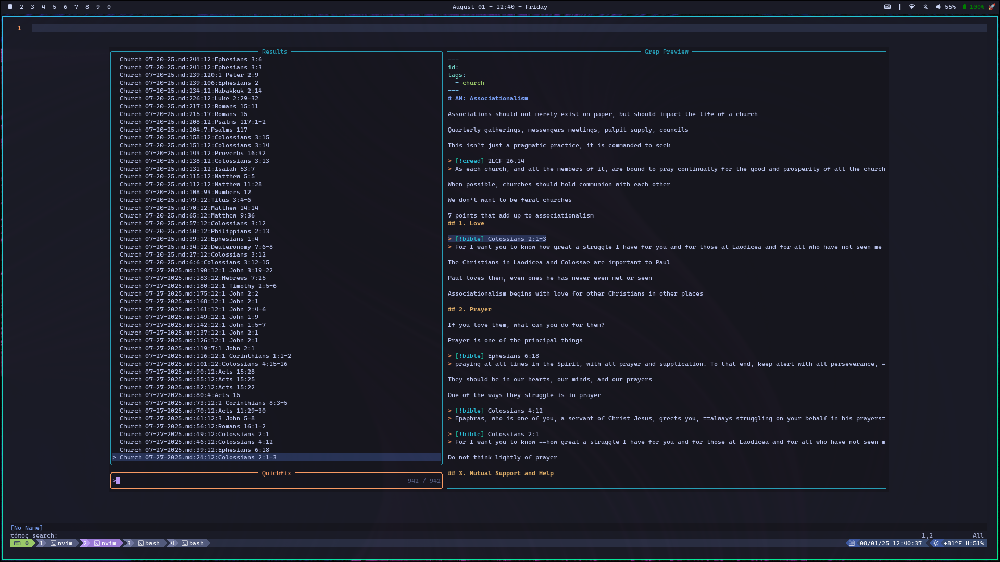

# topos-bible.nvim

Find, search, and complete Bible references in your notes, and read the passages they point to.
It runs [topos](https://github.com/MasterTemple/topos-bible)'s language server (`topos-lsp`)
and searches with its CLI (`topos`).

With [lazy.nvim](https://lazy.folke.io):

```lua
{
  'MasterTemple/topos-bible.nvim',
  main = 'topos',
  -- Builds topos-lsp and topos with Cargo (needs Rust: https://rustup.rs)
  build = ':ToposBuild!',
  dependencies = { 'nvim-telescope/telescope.nvim' }, -- optional
  ft = { 'markdown', 'text' },
  cmd = { 'ToposSearch', 'ToposQuery', 'ToposExplicitOverlap', 'ToposAnyOverlap',
          'ToposExactOverlap', 'ToposInside', 'ToposExcludeOverlap', 'ToposBuild', 'ToposLspStart',
          'ToposBible', 'ToposParallel' },
  opts = {
    -- A folder of USX files, one book each (JHN.usx): hover shows the text, and go to
    -- definition opens the whole book
    bible = '~/Bibles/BSB',
    -- More Bibles: a reference followed by one's name (John 3:16 KJV) uses it
    bibles = { KJV = { path = '~/Bibles/KJV', aliases = { 'AV' } } },
    hover_bibles = { 'KJV' }, -- hover shows the KJV too
    -- How it is written and colored (see :help topos-bible-markup for every key)
    markup = {
      verse_numbers = { show = true, color = 'blue', display = '[{verse}]' },
      words_of_jesus = { show = true, color = 'red' },
      headings = { display = '## {text}', highlight = 'Title' }, -- a group instead of a color
      notes = { show = true, display = '({text})', highlight = 'Comment' },
      width = 80, -- break lines at 80 characters
    },
    -- Code actions that insert a passage below a reference ("Insert Callout")
    insertions = {
      { name = 'Callout', display = '> [!bible] {reference}\n{text}', line_prefix = '> ' },
      -- replace = 'line' (the reference's line), 'inline' (just the reference), or nil (below)
      { name = 'Quote', replace = 'inline', display = '“{text}” ({reference})' },
    },
    -- topos-lsp's settings: the CLI's config.toml keys, which these override
    settings = {
      format = 'name',                        -- or 'abbreviation' for Jn 3:16
      ['psg-fmt'] = { join_adjacent = true }, -- 3:16-18, not 3:16,17,18
      ['reference-diagnostics'] = 'hint',     -- 'info' (default), 'hint', or 'never'
      ['inlay-hints'] = 'never',              -- 'changed' (default), 'always', 'osis', 'never'
      ext = 'md,txt',                         -- what references and searches cover
    },
  },
}
```

- **Language server**: completion, hover, inlay hints, symbols, and diagnostics (each
  reference as formatted, and warnings for verses that don't exist); go to references (`grr`)
  lists the references that are exactly the one under the cursor, and the code actions (`gra`)
  reformat it or search for it by explicit overlap, any overlap, exact overlap, or inside it
- **Bible text**: with `bible`, hovering a reference shows its text (`K`), and so does a
  chapter or verse completion's documentation. Go to definition (`<C-]>`) or declaration opens
  the whole book in a read-only buffer at the passage, with verse numbers, chapters, headings,
  words of Jesus, and so on written and colored the way `markup` says. Go to references on a
  verse there lists every reference to it in your notes, and hovering it counts them
- **Several Bibles**: with `bibles`, a reference followed by a Bible's name (`John 3:16 KJV`)
  uses that Bible for hover, go to definition, completion, insertions, and its own verse counts;
  `:ToposBible KJV` changes the default, and `:ToposParallel KJV` opens the same book in another
  Bible next to the current one, kept on the same verse
- **Insertions**: code actions that write a passage below its reference (like an Obsidian
  callout), in place of its line, or in place of the reference
- **Commands**: `:ToposSearch` (every reference), `:ToposQuery -g Wisdom` (the CLI's options,
  completed with Tab), and `:ToposExplicitOverlap John 3:16`, `:ToposAnyOverlap`,
  `:ToposExactOverlap`, `:ToposInside`, `:ToposExcludeOverlap` (the reference under the cursor
  by default)
- **Telescope**: `:Telescope topos`, plus a picker per search; without Telescope, results open
  in the quickfix list

With [blink.cmp](https://github.com/saghen/blink.cmp), color the passages in its
documentation window too:

```lua
completion = {
  documentation = { draw = function(opts) require('topos').blink_draw(opts) end },
}
```

The plugin and the CLI share `~/.config/topos/config.toml`. See `:help topos-bible`, and
`:checkhealth topos` if something doesn't work.

## Building

`:ToposBuild` installs `topos-lsp` and `topos` into the plugin's `build/` folder with
`cargo install`, from the topos repository on GitHub, or from a checkout of it if you set
`source = '~/path/to/topos'`. Binaries on your `PATH` work too, and `cmd = { lsp = ..., cli = ... }`
picks them yourself.

## Tests

`tests/nvim/run.sh` tests the plugin in headless Neovim, with the quickfix list and with
Telescope if it is installed. It builds the binaries from a topos checkout: `TOPOS`, by default
`../../rust/topos`.

<details>
<summary>Screenshots</summary>





</details>
